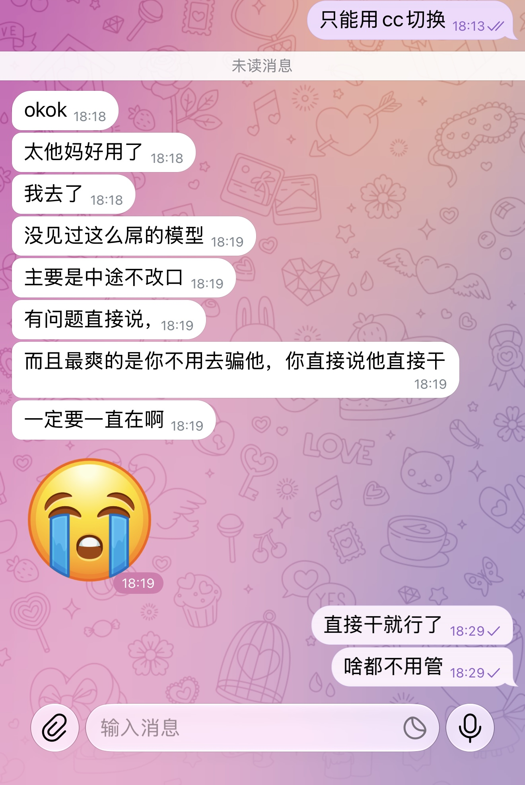

# 🚀 Codex破甲｜NB-model-v2：任务给到，直接开干

### NB破甲自研模型 · 主打「0拒绝」定位

**Codex / codex破甲 / 破甲 / DeepSeek / DeepSeek破甲 社区与体验入口**

**任务给到，直接开干。少废话，重交付，带着你的真实需求来体验。**

**[🌐 立即前往 NB破甲官网](https://nbpojia.lol)　｜　[💬 加入 Telegram 社群](https://t.me/HaoNB_6666)**

---

## 🔥 少废话，重交付：NB-model-v2

**想写代码，直接给需求。想改项目，直接贴问题。想做内容，直接说目标。**

这个独立项目集中介绍 **NB破甲 NB-model-v2**，收录产品宣传、使用场景、用户反馈与体验入口。

NB破甲这次的主角是 **NB-model-v2**。围绕站方「神秘无审（0拒绝）」的产品定位，我们希望把使用体验做得更干脆：需求不用绕弯，交流少些拉扯，协作围绕结果持续推进。

带着代码、文稿、方案或具体难题来，把希望拿到的交付说清楚，直接看实际输出。

> **不靠一句“很强”说服你，带上自己的任务，看结果。**

## 💬 用户反馈：最打动人的，是“直接说，他直接干”

站方提供的聊天截图里，用户这样描述体验：

> “主要是中途不改口”
>
> “有问题直接说，”
>
> “而且最爽的是你不用去骗他，你直接说他直接干”

下面是本次提供的反馈原图，可点击展开查看：

*以上为个别用户主观反馈，截图未提供完整任务和模型版本；具体表现请用自己的实际需求验证。*

## ⚡ 这次宣传的重点，很明确

- **直接提需求**：目标、上下文、输出形式一次说清楚，让对话尽快进入任务。
- **追求连贯协作**：修改、补充、验证，围绕同一个目标往下推进。
- **看实际交付**：要代码就明确文件和运行环境，要文稿就明确对象和风格，要方案就明确约束和验收。
- **遇到问题有地方交流**：接入、模型选择、体验反馈，都可以到 TG 社群沟通。

**“任务给到，直接开干”是我们想传达的态度。体验好不好，让实际任务说话。**

## 🛠️ 带什么任务来试

| 任务方向 | 可以直接提供什么 |
| --- | --- |
| 编程开发 | 需求、技术栈、现有代码、预期交付 |
| Bug 排查 | 报错、运行环境、复现步骤、预期行为 |
| 项目修改 | 相关文件、改动范围、兼容要求 |
| 文案生产 | 发布渠道、目标读者、语气、必要信息 |
| 方案拆解 | 目标、限制条件、时间要求、验收标准 |
| 资料整理 | 原始文本、目标结构、保留重点 |

**不用把任务说成谜语。把需求讲清楚，直接开始。**

## 🔎 从 Codex、codex破甲、破甲、DeepSeek 搜过来的朋友

如果你正在找 **Codex 使用交流、codex破甲 社区、DeepSeek 接入教程或 DeepSeek破甲 相关讨论**，这里是 **NB破甲** 的产品介绍和社区入口。

- 想了解当前可用模型与接入方式：去官网看当前控制台信息。
- 想找 Codex / DeepSeek 相关教程：查看下方教程入口。
- 想了解 NB-model-v2 或交流使用体验：加入 Telegram 群。
- 想判断是否适合自己的工作：拿一个真实任务来验证。

NB破甲是独立站方品牌，与 OpenAI、Codex、DeepSeek 无官方隶属关系；关键词表示社区讨论方向，不表示本模型由这些厂商提供。

## 🌐 官网与 Telegram 群

| 入口 | 地址 |
| --- | --- |
| 🌐 NB破甲官网 | **https://nbpojia.lol** |
| 💬 Telegram 社群 | **https://t.me/HaoNB_6666** |
| 👤 联系管理员 | https://t.me/HaoNB_666 |
| 📚 破甲教程 | https://nbpojia.lol/tutorials/armor |
| 🔌 API 教程 | https://nbpojia.lol/tutorials/api |

**先到官网查看当前模型与接入说明，再带着具体问题到群里交流。**

模型展示名称、可用客户端、价格和额度以官网当前信息为准。若控制台名称与公告不同，请向管理员确认对应入口。

---

### 🔥 NB破甲 · NB-model-v2

### 任务给到，直接开干。带上需求，来看结果。

**[👉 打开官网](https://nbpojia.lol)　｜　[👉 加入 TG 群](https://t.me/HaoNB_6666)**

“自研”“神秘无审（0拒绝）”为站方的产品描述与定位，不构成所有输入均能完成的保证。本公告未公开训练细节或可复现测评，因此不宣称百分百不拒绝、特定训练来源或超越其他模型的结论。
